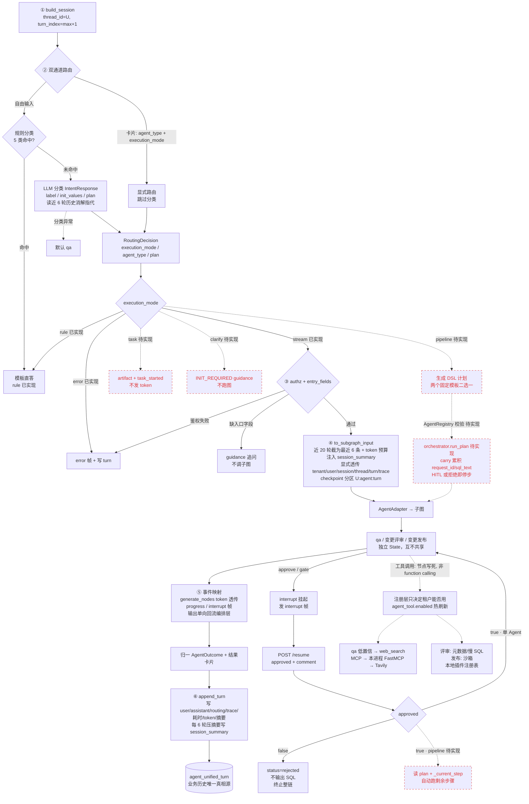
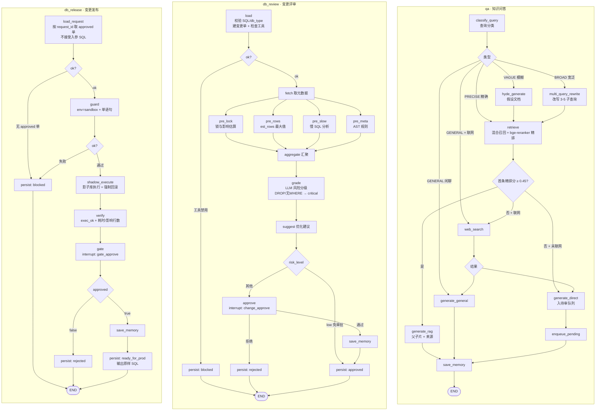

# 数据库变更治理中台

面向数据库变更场景的智能体中台：**规范知识问答 + 变更风险评审 + 沙箱验证发布**，统一咨询入口、人工审批（HITL）、质量评测与可观测。

> 平台**不执行生产变更**：评审只做静态分析，发布只做影子库验证并输出最终 SQL，生产执行由 DBA 人工完成。

---

## 1. 核心能力

| 能力 | 说明 |
|---|---|
| **统一咨询入口** | 一个聊天框承接全部诉求，自动路由到 知识问答 / 变更评审 / 变更发布；真流式（SSE逐字） |
| **知识问答（qa）** | 混合检索（dense+sparse+RRF）→ bge-reranker 精排 → 置信度判定 → RAG / 直答 / Web 兜底；多轮摘要 + 长期记忆；扫描件 OCR |
| **变更评审（db_review）** | 元数据预检（锁/行数/慢SQL/DDL 四路并行）→ 风险分级 → 优化建议 → **人工审批**（HITL） |
| **变更发布（db_release）** | 已审批变更单在影子库沙箱执行 → 断言校验 → **人工放行** → 输出最终 SQL |
| **HITL 审批** | 图内 `interrupt()` 挂起；前端聊天框弹审批框，通过/驳回后**继续流式**，无需刷新 |
| **质量评测** | 人工补充标准答案后触发 RAGAS（忠实度/相关性/上下文精确率与召回/正确性），MQ 异步执行 |
| **会话与记忆** | `agent_thread`（会话）+ `agent_unified_turn`（每轮唯一历史）+ LangGraph checkpoints；短期记忆 Redis、长期记忆 PG |
| **权限与隔离** | JWT + RBAC，`unified:*` 权限点；PG 行级租户隔离、Milvus 租户分区、Redis key 带租户前缀 |
| **可观测** | `trace_id` 全链路（含 SSE）；Langfuse 可选；API 调用日志与监控看板（调用占比、Token 累计、平均耗时） |

---

## 2. 三个业务 Agent

| Agent | 定位 | 执行图（节点） |
|---|---|---|
| **知识问答** `qa` | 基于知识库的检索增强问答，覆盖面最广、作为默认兜底 | `classify_query` →（HyDE / 多查询改写）→ `retrieve` → `grade` → `generate_rag` / `generate_direct` / `generate_general` → `enqueue_pending` → `save_memory` |
| **变更评审** `db_review` | 对**待执行** SQL 做静态风险评审（只分析不执行） | `load` → `fetch`（pre_lock / pre_rows / pre_slow / pre_meta 并行）→ `aggregate` → `grade` → `suggest` → `approve`(interrupt) → `persist` |
| **变更发布** `db_release` | 对**已审批**变更单做影子库验证并输出 SQL | `load_request` → `guard` → `shadow_execute` → `verify` → `gate`(interrupt) → `persist` |

**调用关系**

总览图（编排层调用链与 HITL 恢复）——stream/rule/error 已实现，task/clarify/pipeline 待实现（虚线节点）：



业务 Agent 内部执行图。三张图都是 DAG、无循环，各自独立 State，统一入口显式透传 messages/summary/tenant_id/user_id/thread_id/turn_id/trace_id，输出单向回流编排层。



> 平台不执行生产变更；生产执行由 DBA 人工完成。

---

## 3. 架构概览

```
浏览器（React + antd）
  │  Authorization: Bearer <JWT> + X-Trace-Id
  ▼
FastAPI  /api/v1
  ├─ auth/**      登录 / 身份 / 菜单
  ├─ admin/**     平台管理（超管）：租户 / 用户 / 角色 / 菜单 / Agent / 模型 / 工具 / 配置 / 审计
  └─ tenant/**    租户侧：统一咨询 / 会话 / 问答结果 / 变更单 / 文件 / 看板
  │  middleware: trace_id → api_log → 限流
  ▼
统一编排层  UnifiedGraph（命令式编排类，非 StateGraph）
  ├─ 路由：显式（点卡片/模板）· 隐式（规则5类 → LLM → 兜底 qa）
  ├─ 按 execution_mode 分派到各 Agent 图（独立 thread_id 分区）
  └─ 事件映射：token / progress / reasoning / meta / interrupt / result_card
  ▼
Agent 图（各自编译、独立 State）→ Orchestrator + AgentRegistry
  ▼
PostgreSQL · Redis · Milvus · MinIO · RabbitMQ
```

**存储职责**

| 组件 | 用途 |
|---|---|
| PostgreSQL | 业务表（会话/轮次/变更单/评测/记忆/队列）、权限与审计、LangGraph checkpoints |
| Redis | 短期记忆、配置刷新、停止标记、看板缓存 |
| Milvus | 文档向量（父子片，`tenant_id` 分区键），混合检索 |
| MinIO | 上传文件 / 文档原件 |
| RabbitMQ | 文档解析、RAGAS 测评、审计与通知类异步任务（Outbox + 重试 + 死信） |

---

## 4. 统一咨询的关键机制

**路由**：显式通道（点能力卡片 / 模板问题）跳过分类；隐式通道用规则分类（关键词 → qa / db_review / db_release），未命中再交给 LLM 分类，最终兜底 `qa`。

**SSE 事件**

| 事件 | 含义 |
|---|---|
| `routing_decision` | 本轮路由结果（agent_type / thread_id） |
| `token` | 正文增量 |
| `reasoning` | 思考过程增量（开启「思考模式」且模型支持时） |
| `progress` | 阶段进度（如"正在读取元数据"） |
| `meta` | 出处 / 置信度 / 耗时 / tokens（问答收尾） |
| `interrupt` | HITL 挂起（前端弹审批框） |
| `result_card` | 结构化结果卡片（风险等级、状态、最终 SQL、耗时、tokens） |
| `error` | 失败，带业务 `code` 与 `msg` |

**HITL 审批**：图内 `interrupt()` → 前端弹框 → `POST /unified/chat/resume`（`Command(resume)`）→ **同一消息继续流式**。审批前不展示统计，审批完成后 `result_card` 统一给出「耗时 / tokens」（前后两段合并）。

**会话与记忆**

- `agent_thread`：会话条目（标题首轮自动命名，仅改一次）；
- `agent_unified_turn`：每轮一行，会话历史的**唯一真相源**（回放 / 轮数 / 评测都基于它）；
- `checkpoints`：LangGraph 状态快照（按 `{会话}:{agent}:{轮}` 分区），支撑多轮与 HITL 恢复；
- 短期记忆走 Redis（1 天滑动过期），长期记忆在摘要触发后写入 PG。

**Token 统计**：优先用模型返回的 usage；网关不返回时按字符估算并标 `≈`（前端展示区分）。

---

## 5. 技术栈

- **后端**：Python 3.12、FastAPI、pydantic v2、SQLAlchemy(asyncpg) 手写 SQL、LangGraph / LangChain、sse-starlette、loguru
- **存储**：PostgreSQL、Redis、Milvus、MinIO、RabbitMQ（可选启用，关闭时走 Outbox 缓冲）
- **模型**：LLM 走 OpenAI 兼容接口（可在模型注册表配置）；embedding `bge-m3`、reranker `bge-reranker-v2-m3`、classifier 本地模型；RapidOCR 处理扫描件
- **前端**：React 18 + TypeScript + Ant Design 5 + ProComponents + Recharts + Vite 5
- **质量**：pytest、ruff；`tsc --noEmit`

> 运行时数据访问**不用 ORM**：DAO 全为 `text()` 手写 SQL，ORM 模型仅用于 `scripts/gen_schema.py` 生成 `schema.sql`。

---

## 6. 快速开始

```bash
# 1) 环境
conda create -n agent_platform python=3.12 -y && conda activate agent_platform
pip install -e ".[dev]"

# 2) 配置
cp .env.example .env     # 填 JWT_SECRET、POSTGRES_*、REDIS_*、MILVUS_*、MINIO_*、LLM key

# 3) 中间件
docker compose up -d     # postgres / redis / milvus / minio（rabbitmq 可选）

# 4) 建表与种子（都要执行）
psql -h localhost -U agent -d agent_platform -f scripts/schema.sql
psql -h localhost -U agent -d agent_platform -f scripts/seed_data.sql

# 5) 启动后端（默认 9800）
python backend/main.py

# 6) 启动前端
cd dashboard && npm install && npm run dev    # http://localhost:5173
```

- 种子账号：`admin / 123456`（超管）
- 启动会做**模型就绪自检**：`agent_model_registry` 中 `llm / embedding / reranker / classifier` 各至少一条 `enabled=true`，任一缺失会**终止启动**
- 健康检查 `GET /health?deep=true`；指标 `GET /metrics`
- 前端代理固定走 `http://127.0.0.1:9800`（Windows 下避免 `localhost` 解析到 IPv6 导致 ECONNREFUSED）

**常用环境变量**

| 变量 | 说明 |
|---|---|
| `PORT` | 后端端口（当前 `.env` 为 9800） |
| `RABBITMQ_ENABLED` | 是否启用 MQ（关闭时异步任务只写 Outbox 缓冲） |
| `QA_OCR_ENABLED / QA_OCR_DPI` | 扫描件 OCR 开关与渲染精度 |
| `QA_HIGH_CONFIDENCE_THRESHOLD` | 高置信阈值（精排分数，默认 0.45） |
| `QA_RECALL_TOP_K / QA_RERANK_TOP_K` | 粗排召回数 / 精排保留数 |
| `QA_THINKING_EXTRA_BODY` | 思考模式透传给 LLM 的 `extra_body` |
| `LANGFUSE_*` | 可观测（可选，不配置则关闭） |

---

## 7. 项目结构

```
backend/
  api/           HTTP 接口（auth / admin / tenant / dashboard）
  agents/        各业务 Agent（qa / db_review / db_release）与模板、State
  orchestration/ 统一编排（路由、dispatch、adapter、事件协议）
  rag/           加载、分块、OCR、检索、精排、索引
  services/      会话、意图、评测、附件等应用服务
  data/          DAO / 客户端（PG、Redis、Milvus、MinIO、MQ）
  security/      RBAC 权限点与校验
  server/        启动装配与各 Manager
dashboard/       前端（Vite + React + antd）
scripts/         schema.sql、seed_data.sql、迁移与运维脚本
docs/            设计与说明文档、图
tests/           单测（不依赖真实中间件）
```

---

## 8. 质量与测试

```bash
make test      # pytest -q
make format    # ruff format + ruff check --fix
cd dashboard && npx tsc --noEmit
```

- 测试不依赖真实中间件（DAO / 客户端用替身）；
- 覆盖 schema 一致性、权限映射、会话与回放、看板统计、RAG 流程、统一编排等。
