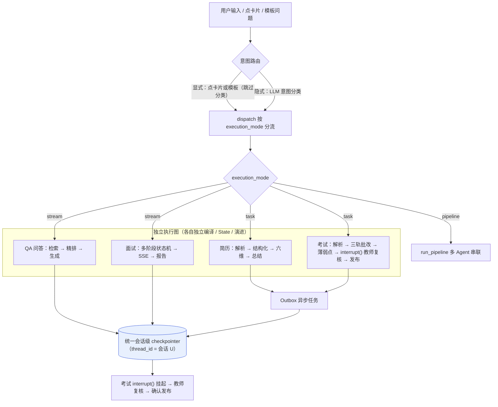
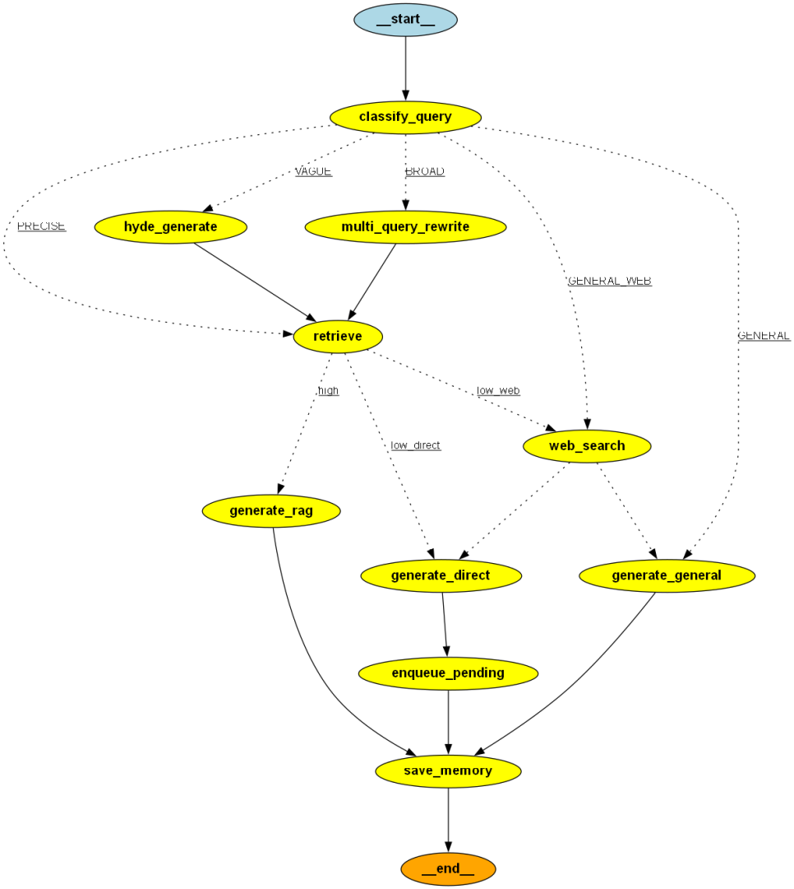
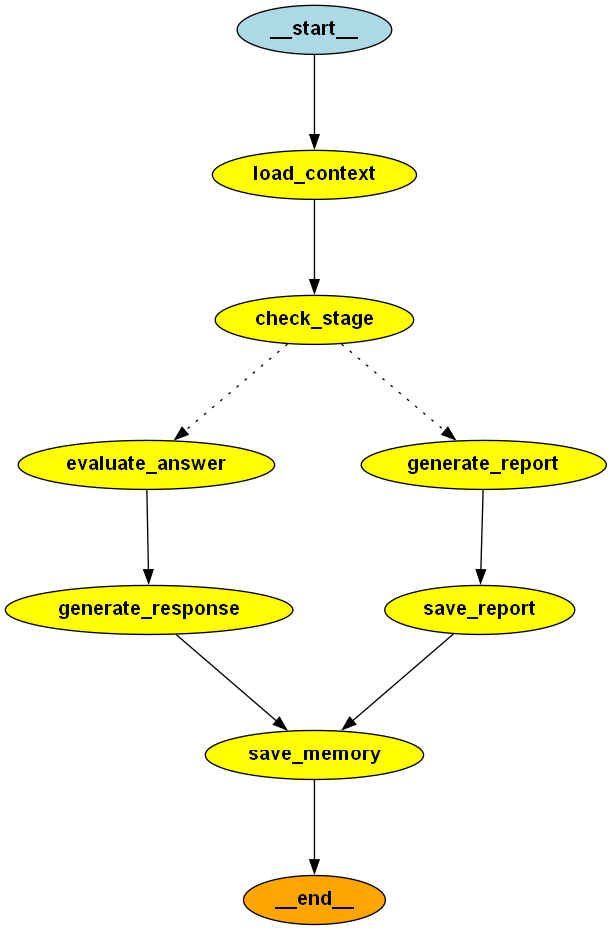
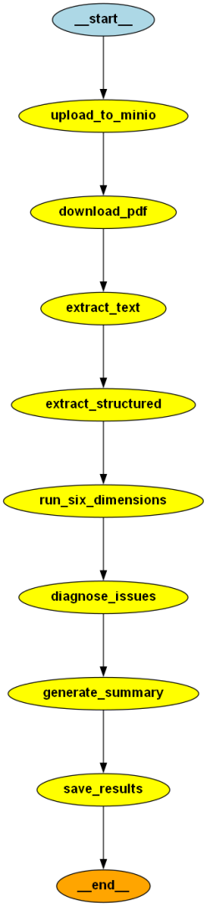
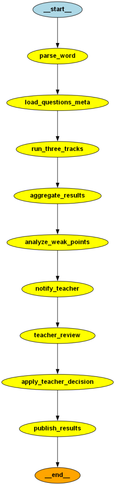
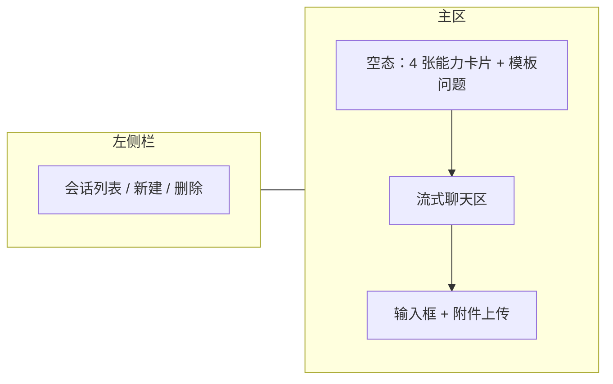
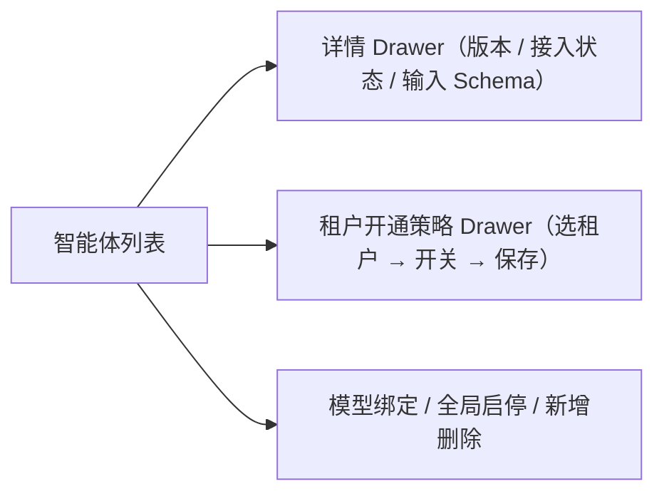
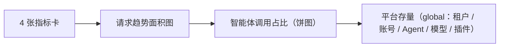

# 多租户多智能体协作平台（Multi-tenant Multi-Agent Collaboration Platform）

---

## 1. 项目定位与价值

- **统一咨询入口**：用户只面对一个对话式入口，四类业务 Agent 的「发起动作」全部收敛；对话型（QA / 面试）实时流式，任务型（简历 / 考试）走异步任务与人工复核（HITL）。
- **扩展零改动**：业务智能体仅需继承 `Agent` 基类即被自动发现、自动注册、自动接入入口、前端卡片与模板由后端规格下发——新增一个 Agent 不动编排层、协议、前端与路由。
- **生产化底座**：多租户 RBAC + 行级隔离、异步解耦（Outbox + 消息队列 + 死信重投）、会话级 `checkpointer`、多模型注册表、配置中心 / 服务发现、统一 SSE 协议与全链路 `trace_id`、审计三日志、质量门禁。

---

## 2. 核心能力一览

| 维度 | 能力 |
| --- | --- |
| 统一咨询入口 | 一个对话流入口，4 个业务 Agent 收敛；意图路由分派到对应 Agent 图；卡片 / 模板 / 路由键由后端 `specs()` 下发，前端不写死 |
| 多智能体编排 | 「统一编排层（薄图）+ 各 Agent 独立编译图」分层；声明式 `AgentSpec` 单一真相源，编排层不写 `if agent_type ==` 分支 |
| 异步任务与 HITL | 简历 / 考试走 Outbox 异步执行；考试批改 `interrupt()` 挂起待教师复核，确认后发布 |
| 多模型治理 | `agent_model` / `agent_model_registry` 驱动运行时；LLM / embedding / reranker / classifier 分类型 active 记录；api_key 出参脱敏 |
| 租户与权限 | JWT + RBAC + scope；业务 / 记忆按 `tenant_id` 行级隔离，Milvus 分区键、Redis `t:{tenant_id}:` 前缀 |
| 可观测与审计 | `trace_id` 贯穿日志与数据；业务 / 登录 / API 调用三套审计日志；请求级 trace 注入；限流 |
| 配置中心与集成 | Nacos 配置中心（Prompt 走 `group=PROMPT` 热刷新）、服务发现；Prompt 缺省回退代码内置 |

---

## 3. 系统架构

```
Browser / 统一咨询前端 (/consultation/*)
      │  Authorization: Bearer <JWT> + X-Trace-Id
      ▼
FastAPI  /api/v1
   ├─ auth/**        登录 / 菜单 / 身份（JWT 签发、登录落库、成功失败均审计）
   ├─ admin/**       整组 require_super_admin：租户/用户/角色/菜单/Agent/模型/插件/配置/审计/消息
   ├─ tenant/**      整组 require_tenant：QA/简历/面试/考试/文件/消息/审计/编排入口
   └─ health / dashboard
      │
      ├─ middleware：trace_id（纯 ASGI，兼容 SSE）→ api_log（落库）→ 限流
      ├─ security：JWT → RBAC 查库 → scopes → require_scope
      ▼
统一编排层  UnifiedGraph（薄图，持有会话级 checkpoint；thread_id = 会话 U）
   ├─ 双通道路由：显式（点卡片/模板，跳过分类）· 隐式（LLM 意图分类）
   ├─ dispatch → 按 AgentSpec.execution_mode 分派
   ├─ 会话 / 历史 / 记忆一次维护，checkpointer 统一为会话级
   ▼
独立执行图（各自独立编译 / 独立 State / 独立演进；复用统一会话级 checkpointer）
   ├─ QA        检索 / 精排 / 生成（多轮，会话上下文由统一层托管）
   ├─ Interview 多阶段状态机 → SSE → 报告
   ├─ Exam      解析 → 三轨批改 → 薄弱点 → interrupt() 教师复核 → 发布
   └─ Resume    解析 → 结构化 → 六维 → 问题 → 总结（线性）
      ▼
Orchestrator + AgentRegistry（自动发现 + 库加载 + 热刷新）
      ▼
PostgreSQL / Redis / Milvus / MinIO / RabbitMQ / Nacos
```

**启动装配**（`server/register.py`，同 order 并行、跨 order 串行、失败回滚）：Logging → Redis/PostgreSQL/Model/Security/Broker → Scheduler/Plugin/Milvus/Checkpointer/Memory → Orchestrator → FastAPI → Nacos 配置中心 → Nacos 服务发现。

---

## 4. 统一咨询入口（核心亮点）

这是本项目架构设计的重点：用「**统一编排层 + 独立执行图**」在收口入口的同时保留各业务图的独立演进能力。

- **入口收敛**：一个流式聊天框，空态展示 4 张 Agent 卡片 + 模板问题；点击卡片即进入对应 Agent 的入口逻辑。收口的仅是「发起 Agent 图执行」这一个动作，结果页 / 报告页 / 详情页保持不变。
- **智能体自动发现**：`Agent` 基类通过 `__init_subclass__` 在子类定义时自动登记，识别与文件路径、文件命名完全解耦。新增 Agent 只需在某处继承并实现，无需在编排器或注册表手动登记。
- **AgentSpec 单一真相源**：意图提示词、scope、卡片、菜单、SSE 标签、checkpoint 分区、观测 tags 全部由 spec 生成；前端按 `event_type` 查渲染器表，不 import 任何 `agents/*`，遵循「平台能力不感知业务」。
- **双通道路由**：点卡片 / 模板问题 = 显式通道（跳过意图分类）；直接输入 = 隐式通道（LLM 分类），`dispatch` 按 `execution_mode`（stream / task / clarify / pipeline）分流到对应图。
- **统一 SSE 协议**：对话型逐字流 `token`；任务型流 `task_started / task_progress / task_result`，考试额外 `review_required` 事件。一套帧协议覆盖所有 Agent。
- **会话 / 历史 / 记忆一次维护**：唯一会话历史源 + 会话级 `checkpointer`；短期记忆（Redis）与长期记忆（PG）分层，与 checkpoint 摘要、turn 历史形成职责清晰的记忆体系。
- **观测一次**：一条 `trace` 覆盖意图分类与所有下游调用（含异步任务），`trace_id` 贯穿日志与数据；失败早暴露——spec 启动期 fail-fast 校验。
- **扩展验收**：新增一个 Agent 仅需实现 `Agent` 子类与声明 `AgentSpec`，前后端改动量趋近于零，这是架构第一约束（D10）。

---

## 5. 工程化与生产能力

- **异步解耦**：业务动作经 Outbox 入队，由 RabbitMQ 投递；死信队列支持重投 / 标记失败，失败态保留错误原因；Broker 未启用时 Outbox 仅缓冲不投递（优雅降级）。
- **持久化与一致性**：会话级 `checkpointer`（PostgreSQL）；`updated_at` 由触发器维护；DAO 全部手写 SQL（`text()`），`data/postgres` 下的 ORM 仅用于生成 `schema.sql`，运行时不用 ORM；统一响应信封 `{code, msg, data}`，业务失败为 HTTP 200 + `code != 0`。
- **多模型注册表**：active 记录驱动运行时取模型；支持 LLM / embedding / reranker / classifier 多类别；api_key 出参脱敏，编辑留空表示保留原 key。
- **配置中心与集成**：`NacosConfigManager` / `NacosDiscoverManager` 分别负责配置中心与服务发现；Prompt 读取 `group=PROMPT`，缺失回退代码内置默认值。
- **安全与隔离**：JWT 验签后查 RBAC 得 `scopes`；`admin/**` 整组超管、`tenant/**` 整组租户上下文（超管无租户，调租户接口 403）；存储按 `tenant_id` 行级过滤，向量 / 缓存按租户分区前缀。
- **可观测与审计**：`trace_id` 全链路（兼容 SSE）；请求内注入 trace 的 loguru 双写；业务 / 登录 / API 调用三套审计日志（租户 / 操作人已 JOIN 名称，支持筛选）；API 级限流。
- **质量门禁**：`pytest`（DAO 与客户端用 AsyncMock 替身，不依赖真实中间件）、`ruff` 格式化与静态检查、`pydantic` 校验边界、`fail-fast` 启动（manager 初始化失败即回滚）。

---

## 6. 技术栈

- **后端**：Python 3.12、FastAPI、pydantic-settings、SQLAlchemy(asyncpg) 手写 SQL、LangGraph / LangChain、sse-starlette、slowapi、loguru、nacos-sdk-python
- **存储**：PostgreSQL（业务 / 权限 / 审计 / checkpoint）、Redis（缓存 / 短期记忆 / 停止标记）、Milvus（RAG 文档向量）、MinIO（文件与简历 PDF）、RabbitMQ（Outbox 投递）
- **模型**：LLM 走 OpenAI 兼容接口；embedding / reranker / classifier 为 bge-m3、bge-reranker-v2-m3、bert-base-chinese
- **前端**：React 18、TypeScript、Ant Design 5、Recharts、Vite 5
- **质量**：pytest、ruff

数据访问约定：运行时**不用 ORM**，DAO 全部 `text()` 手写 SQL；`data/postgres` 仅 `scripts/gen_schema.py` 生成 `schema.sql` 的模型来源。

---

## 7. 快速开始

```bash
# 1) 依赖
conda create -n agent_platform python=3.12 -y && conda activate agent_platform
pip install -e ".[dev]"

# 2) 配置
cp .env.example .env        # 至少填 JWT_SECRET、POSTGRES_*、NACOS_*

# 3) 中间件（PostgreSQL / Redis / Milvus+etcd / MinIO / RabbitMQ；Langfuse 可选）
docker compose up -d
docker compose ps            # 等到 postgres / redis / milvus / minio / rabbitmq 全部 healthy
# 单独拉起/排查：docker compose up -d postgres redis etcd milvus minio rabbitmq
# Milvus 首次启动需初始化 etcd 与索引，冷启动可达数十秒；日志：docker compose logs -f milvus
# Langfuse（可观测，可选）：按官方 compose 拉起后配置 LANGFUSE_* 即生效

# 4) 建库、建表与种子（两个脚本都要执行）
psql -h localhost -U agent -d agent_platform -f scripts/schema.sql
psql -h localhost -U agent -d agent_platform -f scripts/seed_data.sql

# 5) 启动后端
python backend/main.py

# 6) 启动前端（另开终端）
cd dashboard && npm install && npm run dev
```

- 后端默认 `PORT=8000`；本仓库 `.env` 现为 `9800`，`dashboard/vite.config.ts` 代理也指向 `9800`。
- 种子账号：`admin / 123456`（超管）。
- Nacos 未启动时置 `NACOS_ENABLED=false`；Prompt 回退代码内置默认值。
- 启动会做模型就绪自检：`agent_model_registry` 中 llm / embedding / reranker / classifier 各需至少一条 `enabled=true`。
- 运维指标：`GET /metrics`（Prometheus 文本，免鉴权）；健康检查 `GET /health?deep=true`。

## 8. 质量与工程实践

```bash
make test      # pytest -q
make format    # ruff format + ruff check --fix
```

测试不依赖真实中间件（DAO 与客户端用 AsyncMock 替身）。覆盖 schema 与模型一致性、登录日志、菜单与角色、看板统计、权限映射、身份解析、记忆隔离、就绪自检、审计 SQL、API 契约等。

---

## 9. Agent 执行图流程图

统一咨询入口按 `AgentSpec.execution_mode` 把请求分流到各 Agent 独立图；各图独立编译、独立 State、独立演进，但**复用统一编排层的会话级 checkpointer**（`thread_id = 会话 U`）。



### 各 Agent 的 LangGraph 实际编译图

以下为四个业务 Agent 图的实际编译结果（节点名即代码中的 graph 节点）：

**QA 问答图**：`classify_query` 按查询类型分流（精确 / 宽泛 / 精准 / 联网 / 通用）→ 检索或改写 → 按置信度走 RAG / 直答 / 联网 → `save_memory`。



**模拟面试图**：`load_context` → `check_stage` 判定阶段 → 答题评估/生成回应，或生成/保存报告 → `save_memory`。



**简历评审图**：`upload_to_minio` → `download_pdf` → 抽取文本/结构化 → 六维评审 → 问题诊断 → 总结 → 落库。



**考试批改图**：`parse_word` → 加载题目 → 三轨批改 → 汇总 → 薄弱点分析 → 通知教师 → `teacher_review`（`interrupt()`）→ `apply_teacher_decision` → 发布。



---

## 10. 前端界面展示

> 前端为 React 18 + TypeScript + Ant Design 5 单页应用。以下为关键界面的布局示意；实际运行截图放入 `docs/screenshots/` 后，可将下方示意替换为 ``。

### 10.1 统一咨询入口 `/consultation/chat`



### 10.2 智能体管理 `/agents`



### 10.3 监控看板 `/dashboard`


