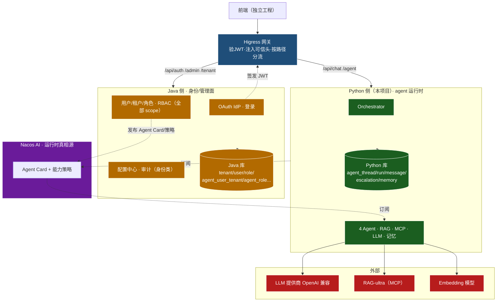

# 基于 Nacos + Higress 的架构演进与拆分规划

> 版本：v1.1 ｜ 日期：2026-11-02 ｜ 作者：架构规划（基于多轮架构评审）
> 关联文档：《多 Agent 系统架构设计方案》（当前代码实况版）、《登录与权限校验说明》（含原《接口与权限梳理》内容）
> 本文性质：**演进规划**。**Nacos 接入（P0：Config / Discovery / AI MCP 发布）已在 Python 侧落地**；其余（Java 身份/admin 拆分、Higress 网关、Agent Card 发布、P5 切流）为待实施规划，代码改动以 task/issue 跟进。
> **v1.1 修订说明**：明确 **polyglot 语言边界**——身份/权限/配置（admin）迁 **Java 侧**，Python 侧仅做 **agent 运行时**，前端独立、经 Higress 分流。《登录与权限校验说明》《多 Agent 系统架构设计方案》**保持不变**，本文为增量规划与边界说明。
> **📌 状态**：**Nacos 接入已实施**（详见 §2.2 / §4.3 / §6-P0）；**Java 侧身份/admin 拆分、Higress 网关、Agent Card 发布与 P5 切流为规划（备案）待做**。当前不启动 Java 拆分、不引入 Higress、不迁移身份表，项目维持现有单应用架构（Python 侧含 auth/admin/RBAC，详见《登录与权限校验说明》）。规划部分落地须以新 task 重新确认后执行。

---

## 0. 背景与目的

当前平台（见《多 Agent 系统架构设计方案》v2.3）是**多模块单应用**：一个 FastAPI 应用内包含 API 层、Orchestrator、四大业务 Agent、RAG 适配、插件缝隙、LLM 工厂、记忆、存储层，通过 `AppServer` + `XXManager` 启动范式装配。

为迈向企业级 AI Agent 平台，并**按语言特长做职责切分**，确定如下演进方向：

- **Java 侧**：身份（OAuth IdP + 登录）、租户/用户/角色、RBAC（全部 scope）、配置中心、身份类审计——即原"admin 域"整体迁 Java。
- **Python 侧（本项目）**：**仅 agent 运行时**——Orchestrator、四大业务 Agent、RAG 适配、MCP、LLM 工厂、记忆、运行时表（thread/run/message/escalation/memory）。
- **Nacos 控制面**：Config（Prompt/参数）、Discovery、**AI 注册（Agent Card / MCP，作为 agent 目录与能力策略的运行时真相源）**。
- **Higress 数据面**：统一 API 网关 + AI 原生能力（LLM 代理、MCP 网关、语义缓存、限流），边缘验 JWT 并注入可信头。
- **前端**：独立工程，经 Higress 按路径分流到 Java（admin/身份）或 Python（agent 域）。

本文目标：把上述 polyglot 拓扑落成设计，明确"控制面登记、数据面治理、语言各司其职"的分工，给出分阶段（含**兼容期双跑 → 切流**）实施规划，并澄清哪些该拆、哪些不拆、哪些与现有 RBAC/租户模型冲突要避免。

---

## 1. 目标架构总览（拓扑）

**连线说明**
- 实线 = 实际调用/数据流；虚线 = 注册/发现/签发来源。
- `IDP -.签发 JWT.-> H`：Java 作 IdP 发证，Higress 在边缘验签并注入 `X-Tenant-Id/X-User-Id/X-Scopes`。
- `IAM -.发布.-> CARD` + `CARD -.订阅.-> AG`：agent 目录与能力策略以 **Nacos AI 为运行时真相源**——Java 改完发布，Python 订阅消费，两端不各存一份。
- 前端统一从 Higress 进；`/api/auth|/admin|/tenant` 走 Java，`/api/chat|/agent` 走 Python。

---

## 2. 现状 vs 目标（对齐现有设计）

### 2.1 现状（已实现，来自《多 Agent 系统架构设计方案》）

| 层 | 现有实现 | 目标架构中的归属 |
|---|---|---|
| 服务启动器 | `AppServer` + `XXManager` | Python 侧保留（agent 运行时） |
| 配置 | `ConfigManager` → `app_state.settings` | 接 **Nacos Config**（增强，非替代） |
| 存储 | PostgreSQLManager / RedisManager / MilvusManager / BrokerManager | Python 侧保留（运行时表） |
| 模型 | `ModelManager` + `LLM Factory` | Python 侧保留；LLM 出口可经 Higress 代理 |
| 编排 | `OrchestratorManager` + `AgentRegistry`（继承自动发现的 Agent 图） | Python 侧保留（应用内核） |
| RAG | `RagAdapterManager` + `backend/rag` | Python 侧保留；外部 RAG 经 MCP 接入 |
| 插件 | `PluginManager` + `backend/plugins` | Python 侧保留；MCP 作为一类外部插件 |
| 鉴权 | `middleware/auth.py` + `security/security.py` 的 `require_scope` 等 | **整体迁 Java 侧**（见 §3）；Python 侧切流后只信网关注入声明 |
| 多租户 | 全链路 `tenant_id`；PG 行级 + Milvus partition key + Redis 前缀 | Python 侧**保留行级 `tenant_id` 隔离**（隔离底线在存储层） |

### 2.2 Nacos 接入现状（已落地，Python 侧）

- `NacosConfigManager`：对接 Nacos Config，承载配置中心审批与 Prompt 动态读取。
- Prompt 消费已落地：`qa` / `db_review` / `db_release` 各自 `resolve_prompt()` 按 `group=PROMPT` 读取 `qa_*` / `db_review_*` / `db_release_*` data_id；Nacos 缺失/不可达时回退代码内置默认值（内容仍以代码为准）。
- `NacosDiscoverManager`：对接 Nacos Discovery。
- `NacosAIManager`（**已新建，单测 5 passed**）：启动时把**平台 MCP Server** `release_mcp_server` 到 Nacos AI（`order=75`）。
  - 限制：当前 SDK（`v2.nacos.ai`）仅支持 `release_mcp_server` 与 `release_agent_card` 两类发布；**Prompt / Skill 无发布接口**（消费侧 `get/subscribe` 可用）。

---

## 3. 语言边界与职责切分（polyglot 决策）

本拓扑的核心决策已在评审中拍板，本节固化。

### 3.1 四决策

| # | 决策点 | 结论 |
|---|---|---|
| D1 | 细粒度 RBAC 授权（租户/角色/scope）由谁做 | **Java 统一做**；Python 只信网关注入的声明 + 做 `tenant_id` 隔离，**不再做 scope 校验** |
| D2 | agent 目录与能力策略的真相源 | **Nacos AI Agent Card**（Java 发布、Python 订阅，两端同读一份） |
| D3 | 身份表 vs 运行时表归属 | **身份表（tenant/user/role/agent_user_tenant/agent_role…）迁 Java 库**；**运行时表（agent_thread/run/message/escalation/memory）留 Python 库**；Python 从 token 取 tenant/user，**不再验证身份** |
| D4 | Python 现有 auth/login/admin 代码 | **保留兼容期（双跑灰度）**，确认 Java 侧稳定后再删 |

### 3.2 必须锁死的 3 个细节

**① 两类"门"不混为一谈**
- **RBAC scope**（如 `exam:ask`、`config:update`）→ Java 统一校验，Python 完全不管。
- **agent 能力策略**（某租户是否开通某 agent，即原 `agent_capability_policy`）→ 这是**运行时门禁、非 RBAC scope**。Python 在调用 agent 前，按从 Nacos AI 订阅到的卡片/策略判断 `enabled`。否则 Java 放行了、Python 却无脑执行，租户开关会失效。文档与实现都必须把"scope 校验"和"能力策略门禁"分开。

**② Nacos AI 是"运行时真相源"，Java 库是"管理落库"**
为避免"单一来源 = 单点"风险，采用：
- **Java 库**存 agent 目录/策略（可编辑 + 审计），Java admin 改完由 Java 侧 `release` 到 Nacos AI 分发；
- **Nacos AI** 是 Java 与 Python **运行时**共同读取的那一份；
- **Python** 订阅消费并缓存。
即 Nacos 作两端运行时读的同一份，Java 库作管理侧写的那份，既不双写互为主源、也不把编辑/审计押死在 Nacos。

**③ 兼容期（双跑）机制**
- 期间：Higress 已把 auth/admin 路由到 Java；但 Python **仍保留**自己的 `login`/`admin` 作为回退，且 Python 仍自验 JWT（可能存在无 Higress 的调用路径）。
- **切流判据**：Java 身份/admin 稳定 + Higress 验签可靠 → Python 删除 `middleware/auth.py` 验签与 `api/v1/admin/*`，改为**只信网关声明**（仅做 `tenant_id` 隔离 + 能力策略门禁）。
- 这一步必须写进分阶段规划，否则实现时不知道何时能删旧代码。

### 3.3 职责边界表

| 关注点 | Java 侧 | Python 侧（本项目） | 前端 | Higress | Nacos AI |
|---|---|---|---|---|---|
| 登录 / 令牌签发 | ✅ OAuth IdP | ❌（切流后） | 调 `/api/auth/login` | 验签+注入头 | — |
| 用户/租户/角色 | ✅ | ❌ | 经 Java | — | — |
| RBAC（全部 scope） | ✅ | ❌ | — | 粗路由 | — |
| 配置中心 | ✅ | 消费 | — | — | Config |
| 身份类审计 | ✅ | ❌ | — | — | — |
| agent 目录/策略（编辑） | ✅（落库+发布） | ❌ | 经 Java | — | ✅ 运行时真相源 |
| agent 运行时（编排/4 agent/RAG/MCP/LLM/记忆） | ❌ | ✅ | 经 Python | 路由 | 订阅 |
| agent 执行审计（run/escalation/tool） | ❌ | ✅ | — | — | — |
| 运行时表 | ❌ | ✅（PG/Milvus/Redis/MQ） | — | — | — |

---

## 4. 各层职责与落地映射

### 4.1 接入层 Higress（数据面）

| 能力 | 职责 | 说明 |
|---|---|---|
| API 路由 / 鉴权 / 限流 | TLS 终结、边缘 JWT 验签、全局限流、WAF、未登录整体拦截、按路径分流（Java / Python） | 接管认证（authn）+ 粗路由 |
| 可信头注入 | 验签后注入 `X-User-Id/X-Tenant-Id/X-Scopes`，**必须覆盖客户端同名头**防伪造 | Python 切流后只信这些头 |
| LLM 代理 | 多模型路由/降级、Token 限流、语义缓存、Prompt 安全 | LLM Factory 指向代理端点即可 |
| MCP 网关 | 聚合多个 MCP Server、工具级鉴权、可观测 | RAG-ultra 等外部能力收口成受管端点 |

### 4.2 Java 侧（身份/管理面，本次新增）

- **OAuth IdP**：签发 JWT（含 `user_id` / `tenant_id` / `scopes` / `roles`）；提供 JWKS 供 Higress 验签，或共享对称密钥。
- **用户/租户/角色 + RBAC**：接管原 `middleware/auth.py`、`security/rbac.py`、`security/security.py` 的判定逻辑与 `agent_user_tenant` / `agent_role` / `agent_role_permission` 等表（迁 Java 库）。
- **配置中心 / 身份类审计**：Prompt 走 Nacos Config；身份/权限/配置变更审计落 Java 库。
- **agent 目录与策略管理**：提供 admin CRUD UI/API，落 Java 库后 `release_agent_card` 到 Nacos AI。

### 4.3 控制面 Nacos

| 子系统 | 职责 | 本项目落地状态 |
|---|---|---|
| **Nacos Config** | Prompt/参数动态推送 | ✅ 已接（`NacosConfigManager`） |
| **Nacos Discovery** | 服务注册发现 | ✅ 已接（`NacosDiscoverManager`） |
| **Nacos AI** | MCP Server / Agent Card / 能力策略 = 运行时真相源 | ⚠️ MCP Server 已发布；Agent Card 待做（SDK 已支持）；能力策略由 Java 侧发布 |

### 4.4 Python 侧（agent 运行时，本项目内核）

保持**单应用多模块**的 agent 运行时不变（与《多 Agent 系统架构设计方案》内核一致）。增量只在：
- 发布 Agent Card 到 Nacos AI（P1，由 Python 或 Java 触发，见 §6）；
- 经 MCP client 接入 RAG-ultra（P2）；
- 切流后：移除自验签与 admin 接口，改信 Higress 注入声明 + 按 Nacos AI 订阅做能力策略门禁（P5）；
- 可选：LLM 出口指向 Higress LLM 代理（P4）。

### 4.5 数据面 / 外部

PG / Redis / Milvus / MQ / LLM / Embedding / RAG-ultra 拓扑与现有设计一致；**运行时表留 Python 库**，身份表在 Java 库，调用路径随 Higress 引入而前移一层。

---

## 5. 关键技术决策（评审结论沉淀）

### 5.1 Nacos AI 与 Higress：控制面 vs 数据面，MCP 段互补
Nacos AI 管"AI 资产在哪、是什么"（注册/发现/版本，不转发流量）；Higress 管"流量怎么走、安不安全"，且可直接以 Nacos AI 为 MCP/服务来源。重合仅在 MCP，二者互补。

### 5.2 RBAC 归 Java，Python 不重复
对应《登录与权限校验说明》的六层纵深：**认证与授权整体迁 Java**（IdP + RBAC）。Python 切流后只做两件事——**行级 `tenant_id` 隔离**（存储层底线）+ **agent 能力策略门禁**（运行时，非 scope）。**反模式**：在 Higress 或 Python 重写细粒度 RBAC → 策略散落、租户隔离与动态权限失效。

### 5.3 Prompt / Skill 走 Nacos Config（SDK 限制）
安装版 SDK 只有 `release_mcp_server` 与 `release_agent_card` 两个发布方法，无 `release_prompt` / `release_skill`。Prompt 维护沿用 Nacos Config；Skill 暂以配置中心/对象存储承载。

### 5.4 Agent Card 现在就做（SDK 已支持）
`release_agent_card` + `register_agent_endpoint` / `deregister_agent_endpoint` 已在 SDK 中存在。数据来源复用 `AgentRegistry` 的 `AgentMeta`（`name/description/version/enabled`），配置只给连接信息与 endpoint 路径。按 D2，Agent Card 由 **Java 侧发布**（管理落库在 Java），Python 订阅消费。

### 5.5 RAG 接入默认走 MCP
RAG-ultra 若提供 MCP Server，平台经 `MCPRegistry`/`PluginRegistry` 发现并调用（沿用插件协议 + 租户开关 + 错误边界）；若仅 REST，则直连 API 封装为 tool，后续再包 MCP。调用透传 `tenant_id` → Milvus partition key。

### 5.6 4 个 Agent 默认不拆独立服务
本决策下，4 个 agent **留在 Python 单运行时**，不拆服务；Nacos AI 只作"对外暴露 + 发现外部 agent"窗口。拆服务需另建 A2A 传输层 + 委托身份 + 编排外移（见 §7），默认不做。

### 5.7 身份表迁 Java / 运行时表留 Python
按 D3：身份表（tenant/user/role/agent_user_tenant/agent_role/agent_role_permission/menu/身份类审计）归 Java 库；运行时表（agent_thread/run/message/escalation/memory/plugin/tool）留 Python 库。Python 从 token 取 tenant/user，**不再验证身份**，但查询仍强制 `tenant_id` 过滤。

### 5.8 Nacos AI 作 agent 目录/策略运行时真相源
按 D2：Java 改完 agent 目录/策略 → `release` 到 Nacos AI；Python 订阅消费。两端不各存一份，消除双源同步（呼应 §3.2 ②）。

---

## 6. 分阶段实施规划

> 每个阶段独立可交付、可回退。P0 已完成；P3 起引入 Java 侧与 Higress；P5 为切流（删 Python auth/admin）。

### P0 · Nacos 接入地基（已完成，Python 侧）
- [x] `NacosConfigManager` / `NacosDiscoverManager` / `NacosAIManager`（`release_mcp_server`，单测 5 passed）。
- [x] `app_state.nacos_ai` 槽位、`register.py` `order=75`、`NacosAISettings` 发布字段。

### P1 · Nacos AI 完善（下一步）
- [ ] Agent Card 发布逻辑就绪（`release_agent_card` + builder 映射 `AgentRegistry` → `AgentCard`）。
- [ ] 明确 **由 Java 侧** 发布 Agent Card/策略（D2/D4）：Java admin 改完落库并 `release` 到 Nacos AI；Python 订阅消费。
- [ ] 确认 Prompt 走 Nacos Config。
- [ ] 单测：Agent Card 构造/发布/禁用跳过、环境无 SDK 时软降级。

### P2 · RAG
- [x] 已改为 `backend/rag/` 自研闭环（读写同库 `agent_rag_docs`），移除外部 MCP/包导入/HTTP 适配层。
- [x] 多租户：`tenant_id` 作为 Milvus partition key，写入与检索两侧都带租户隔离。
- [ ] 若将来需跨系统共享检索能力，再经 Nacos AI 发现并以插件协议暴露（租户开关 + 错误边界）。

### P3 · Java 侧承接身份/admin
- [ ] 新建 Java 侧（IdP + 用户/租户/角色 + RBAC + 配置中心 + 身份类审计），库表从 Python 迁 Java。
- [ ] 接管《登录与权限校验说明》中"认证/授权/审计"职责（本文只说明边界，不改那两篇文档）。
- [ ] Java admin 提供 agent 目录/策略 CRUD，落 Java 库后 `release_agent_card` 到 Nacos AI。

### P4 · 引入 Higress（治理增强）
- [ ] Higress 边缘验 JWT + 注入可信头（覆盖客户端同名头）+ 按路径分流（Java `/auth|/admin|/tenant`，Python `/chat|/agent`）。
- [ ] LLM Factory 指向 Higress LLM 代理（可选）；MCP 网关聚合 RAG-ultra。
- [ ] **兼容期**：Python 仍保留自验签与 admin 作为回退；Higress 与 Java 并行验证。

### P5 · 切流（删 Python auth/admin，改信网关声明）
- [ ] 判据：Java 身份/admin 稳定 + Higress 验签可靠。
- [ ] 删除 Python `middleware/auth.py` 验签逻辑与 `api/v1/admin/*`、`api/v1/auth/*`、`api/v1/tenant/*` 等身份/admin 接口。
- [ ] Python 改为读 Higress 注入声明组装身份上下文；保留 **行级 `tenant_id` 隔离** 与 **agent 能力策略门禁**（按 Nacos AI 订阅）。
- [ ] 身份类审计改由 Java 侧落库。

### P6 ·（可选）4 Agent 独立服务化
- [ ] 仅当独立部署/扩容/多团队自治时启动；需 A2A server/client + 跨服务委托身份 + 编排外移。默认不做。

---

## 7. 服务化拆分的取舍（决策依据）

| 场景 | Nacos AI 角色 | 是否拆服务 | 备注 |
|---|---|---|---|
| 4 Agent 同进程（本决策默认） | 对外暴露窗口 + 发现外部 agent | **否** | 进程内 `AgentRegistry` 发现更快，无网络依赖 |
| 独立部署/扩容/多团队 | 真正发现中枢 | **是** | 需 A2A + 委托身份 + 编排外移 |
| 仅想被外部/跨系统调用 | 注册表 | **否** | 单运行时 + Agent Card 发布即可（P1） |

**原则**：Nacos AI 注册是"简单且已具备"的部分；真正成本在传输层与身份。不要把"4 个本地 agent 迁到 Nacos 管理"当省成本手段——本地互调用 Nacos 是绕远路且引入双源同步（已由 D2 的"Nacos 作运行时真相源"规避）。

---

## 8. 配置与环境变量汇总

### 8.1 已存在（Nacos 系列，env 前缀一致）
| 前缀 | 用途 |
|---|---|
| `NACOS_CONFIG_*` | Nacos Config 连接（Prompt/参数） |
| `NACOS_DISCOVERY_*` | Nacos Discovery 连接 |
| `NACOS_AI_*` | Nacos AI 连接 + 发布（含 `PUBLISH_MCP` / `MCP_SERVER_NAME` / `MCP_ENDPOINT_PATH` / `STRICT` 等） |

### 8.2 规划项（随阶段补）
| 配置 | 阶段 | 说明 |
|---|---|---|
| Java IdP：`OIDC_JWKS_URL` / 共享密钥 | P3 | Higress 与 Python（兼容期自验）验签用 |
| `HIGRESS_ENABLED` | P4 | 是否前置 Higress |
| `HIGRESS_LLM_PROXY_URL` | P4 | LLM Factory 指向的 LLM 代理端点 |
| `HIGRESS_MCP_PROXY` | P4 | 是否由 Higress 聚合外部 MCP |
| `TRUST_PROXY_HEADERS` | P5 | Python 切流后信任 Higress 注入头（**必须**让 Higress 覆盖客户端同名头） |

> 待办：将上述新增项补进 `.env.example`（属文档/配置收尾，非业务代码改动）。

---

## 9. 风险与回退

| 风险 | 影响 | 缓解 / 回退 |
|---|---|---|
| SDK 落后（Prompt/Skill 无发布接口） | 不能发布到 AI 中心 | Prompt 走 Nacos Config；Skill 走配置中心/对象存储 |
| Higress 引入带来 Envoy/K8s 运维成本 | 团队负担 | P4 才引入，可暂缓；兼容期内 Python 自验照常 |
| Nacos AI 反发布接口缺失 | `stop` 仅释放连接；`release` 为创建语义，同名同版本重复会 409 | 启动期已改为幂等（先 `get_mcp_server` 后 `release`，409 兜底跳过），重启不再因重复发布失败 |
| **Nacos AI 作运行时真相源的单点** | Nacos 抖动致两端盲 | Java 库保留可编辑副本 + 发布；Python 订阅并缓存卡片；Nacos 恢复后自动重订阅 |
| **兼容期双跑的不一致** | Java/Python 各有一套身份逻辑 | 明确 P5 切流判据；切流前 Python admin 仅作回退、不对外主用 |
| **Higress 头伪造** | 客户端自带 `X-User-Id` 等绕过 | Higress **必须覆盖**同名头；Python 仅在 `TRUST_PROXY_HEADERS=true` 且经网关时信任 |
| 双源真相 | 一致性混乱 | D2 已定 Nacos AI 为运行时真相源，Java 库为管理落库，单向发布 |

---

## 10. 与现有文档的关系

- **《多 Agent 系统架构设计方案》**（当前实况版）：单应用内核（AppServer/Manager、LangGraph 编排、插件化、租户隔离、存储分工）**保持不变**；本文只把其中"admin/身份"职责标注为迁 Java 侧。
- **《登录与权限校验说明》**：其"认证/授权/审计"职责在**目标架构中迁 Java 侧**，但**该文档本身不改**（维持单体视角）。本文 §3/§5.2/§5.7 仅说明边界与切分，不修改其正文。
- **本文定位**：polyglot 演进的**增量规划与边界说明**——明确 Java（身份/admin）、Python（agent 运行时）、Higress（网关）、Nacos AI（运行时真相源）如何协同，以及兼容期双跑 → P5 切流如何落地。

---

## 11. 后续动作建议（待确认）

1. **P1 范围确认**：Agent Card 发布由 **Java 侧** 触发（D2/D4），还是暂由 Python 侧 `NacosAIManager` 代发？建议 Java 侧接管以贴合真相源归属。
2. **RAG-ultra 形态**（P2 前置）：已有 MCP Server / 仅 REST / 需适配？决定直连还是 MCP。
3. **Higress 底座**（P4）：当前是否已有 K8s/Envoy？若无，P4 暂缓，兼容期拉长。
4. **Java 侧库表迁移**（P3）：身份表从 Python 迁 Java 的迁移脚本与双写策略需单独 task。
5. **`.env.example`**：把 §8.2 新增配置项落档（非代码改动）。
6. **切流判据**（P5）：明确"Java 稳定 + Higress 可靠"的可验收标准，避免 Python 旧代码长期双跑。
